# CSS Assignments

A collection of frontend projects created using HTML and CSS to improve my web development skills through practical assignments.

## Technologies Used

- HTML5
- CSS3

## Projects

| No. | Project | Source Code |
| --- | --- | --- |
| 01 | Superwars | [View Code](./01.superwars/) |
| 02 | Calculator | [View Code](./02.calculator/) |
| 03 | Sudoku | [View Code](./03.sudoku/) |
| 04 | Ludo | [View Code](./04.ludo/) |
| 05 | Super Over | [View Code](./05.superover/) |
| 06 | Cricket App | [View Code](./06.cricket_app/) |
| 07 | Kidz World | [View Code](./07.kidz-world/) |
| 08 | YouTube | [View Code](./08.youtube/) |
| 09 | Amazon | [View Code](./09.amazon/) |
| 10 | Spotify | [View Code](./10.spotify/) |
| 11 | Netflix | [View Code](./11.netflix/) |

## Project Outputs

### 01. Superwars

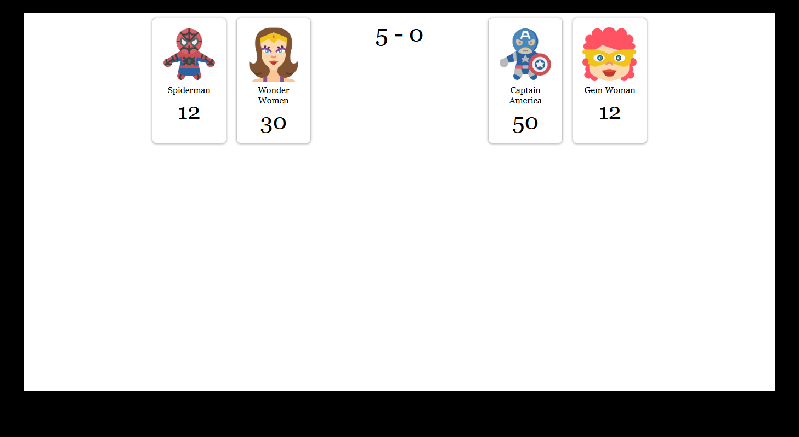

### 02. Calculator

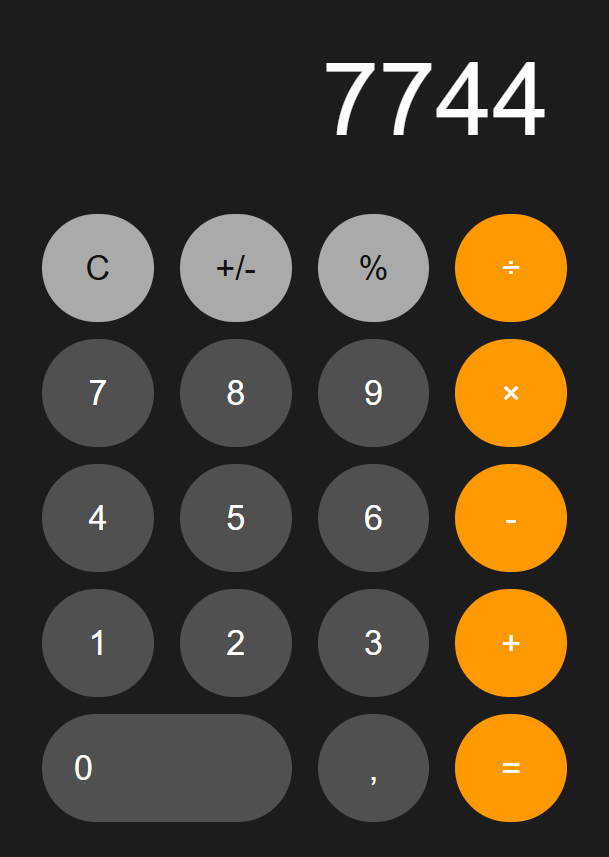

### 03. Sudoku

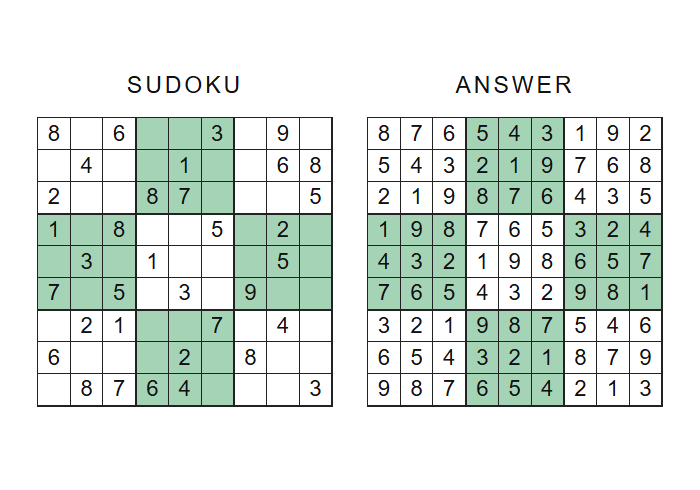

### 04. Ludo

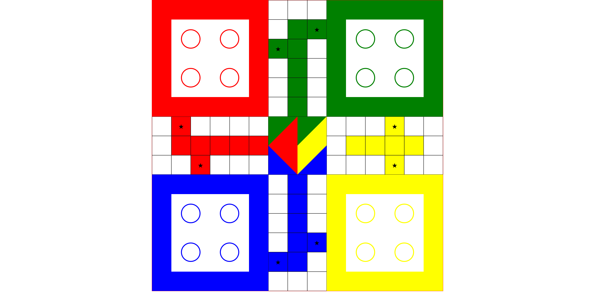

### 05. Super Over

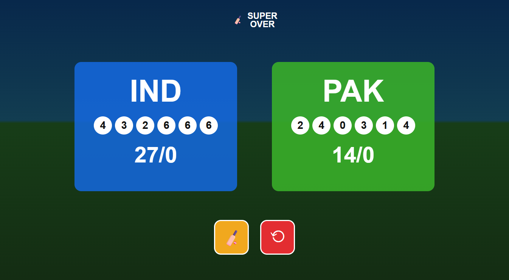

### 06. Cricket App

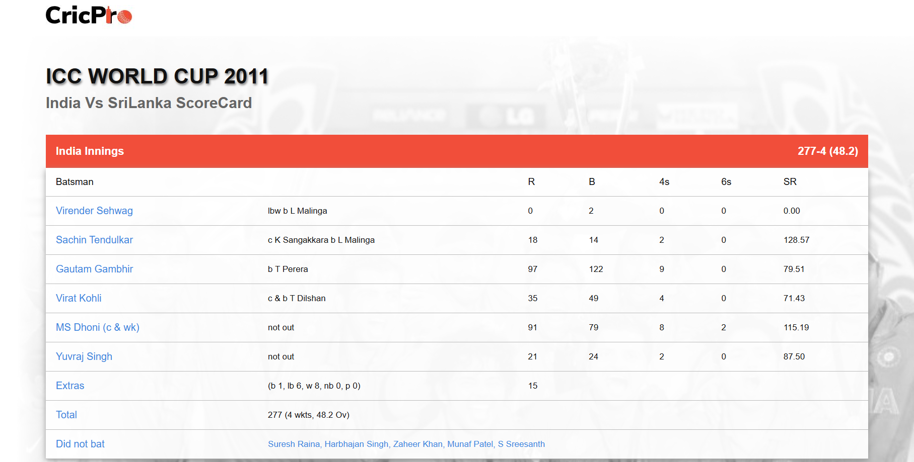

### 07. Kidz World

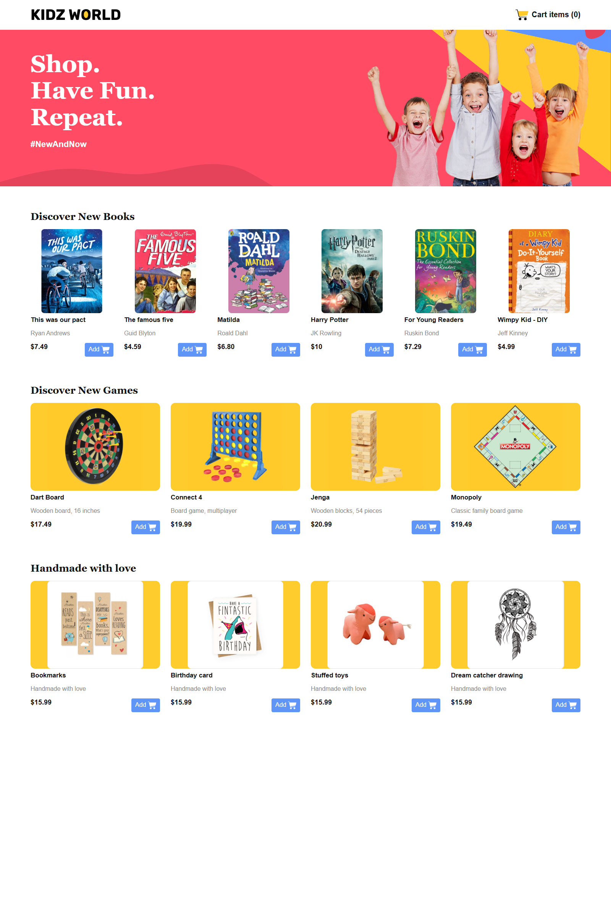

### 08. YouTube

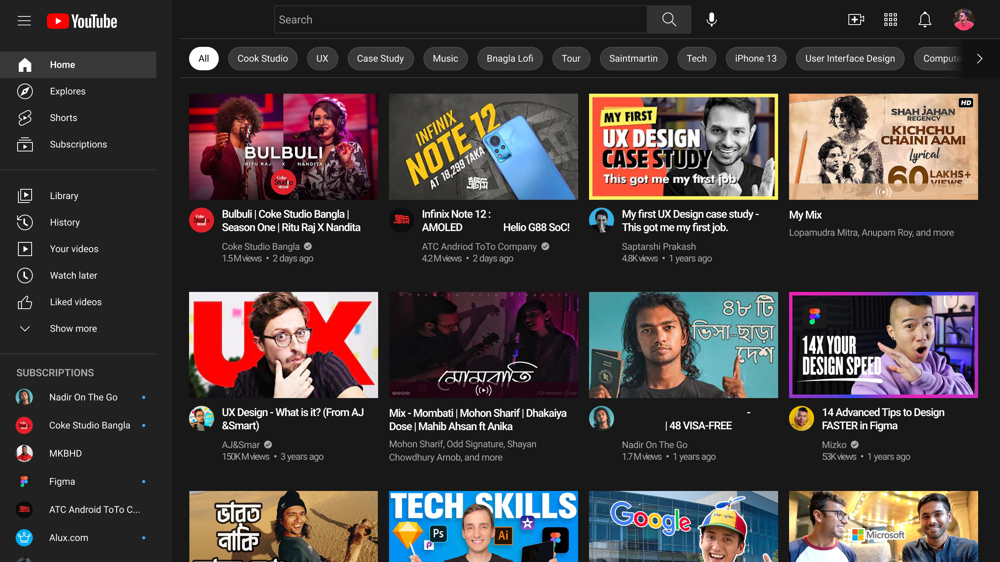

### 09. Amazon

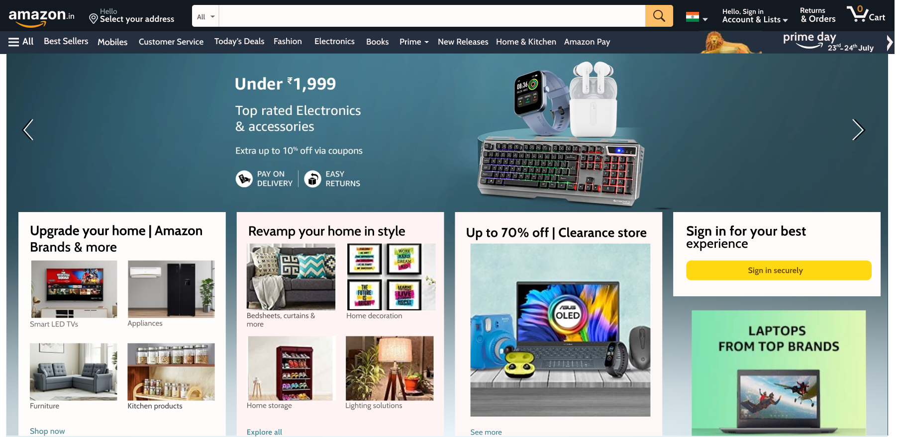

### 10. Spotify

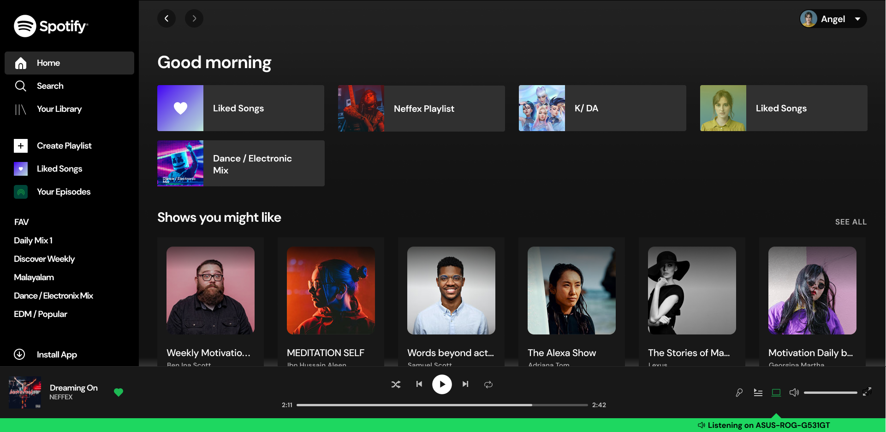

### 11. Netflix

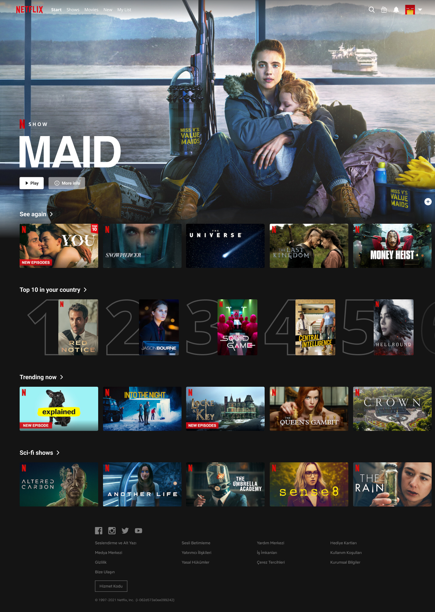

## How to Run

1. Download or clone this repository.
2. Open any project folder.
3. Open the `index.html` file in your browser.

## Learning Objectives

- Understanding HTML structure.
- Improving CSS styling and layouts.
- Practicing Flexbox and Grid.
- Recreating real-world website interfaces.
- Improving frontend development skills.

## Author

**Neel Parmar**

CodingGita | Frontend Development

---

Created as part of my web development learning journey.
